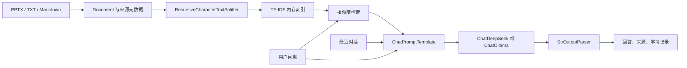

# 课伴 CourseMate：基于 LangChain 的课程资料智能助手

> 《开源软件构建技术》第七章课程作业。面向软件工程专业学生，用课程资料回答问题、整理复习提纲和生成带依据的练习题。

**开源仓库链接：待发布 GitHub 后填写真实地址。当前尚未发布，不应将本行作为最终提交链接。**

## 1. 项目简介

复习时，学生往往需要在多个课件中查找知识点。直接询问大模型可能得到与课程资料不一致的答案。本项目先检索用户上传的课件和笔记，再通过 LangChain 把相关片段交给大模型生成回答，并展示来源文件与页码，帮助学生核验内容。

项目使用 Python 与 Streamlit 构建本地交互界面，支持 DeepSeek 在线模型和 Ollama 本地模型。无需密钥也能体验文档解析与检索，但“检索体验”只返回原文，不属于大模型生成。

验证状态（2026-10-29）：22 项自动化测试通过；用户已在本机确认 DeepSeek 密钥认证通过、真实问答成功。Ollama 接口已实现，尚未进行真实本地模型验收。

## 2. 已实现功能

| 功能 | 说明 |
| --- | --- |
| 资料导入 | 支持 PPTX、UTF-8 TXT 和 Markdown，最多 10 个文件，每个不超过 60 MB，总文字不超过 100 万字符 |
| 自动分块 | 使用 RecursiveCharacterTextSplitter，700 字符分块、100 字符重叠 |
| 本地检索 | 字符 2–4 gram TF-IDF 与余弦相似度，最多返回 2–6 个相关片段，并过滤低分结果 |
| 资料问答 | 根据检索片段生成中文回答，提示模型为关键结论标注 [1] 等引用 |
| 复习辅助 | 针对指定主题生成提纲、解释概念或练习题，使用同一条 RAG 链 |
| 来源核验 | 展示本轮提供给模型的原文、文件名和 PPTX 页码 |
| 对话上下文 | 每个浏览器会话独立保存对话，模型仅接收最近 6 条消息 |
| 记录导出 | 下载 Markdown 学习记录，包含运行模式和参考原文 |
| 失败处理 | 处理空文件、格式错误、密钥缺失及模型连接失败 |

## 3. 与第七章课件的对应关系

学习依据：王莹，《开源软件构建技术》第 7 章《开源智能应用开发案例》，2025，用户提供的 76 页课件。

| 课件知识点 | 对应实现 |
| --- | --- |
| 第 15–21 页：在线调用与框架调用 | `ChatDeepSeek` 通过在线 API 生成回答 |
| 第 23–27 页：离线模型调用 | `ChatOllama` 连接本机模型服务 |
| 第 31–37 页：LangChain 核心组件 | Document、文本分割器、ChatPromptTemplate、MessagesPlaceholder、输出解析器 |
| 第 39–41 页：文本总结 | 根据指定主题检索相关片段，再生成复习提纲 |
| 第 43–53 页：RAG | 文档加载、分块、索引、检索、提示构造、模型生成、来源展示 |
| 第 73–74 页：对话历史管理 | Streamlit 会话状态与最近 6 条消息裁剪 |

课件中的部分示例使用较早的导入路径或 `LLMChain` / `RetrievalQA`。本项目采用 LangChain 当前拆分的组件包与 LCEL 表达式 `prompt | model | StrOutputParser()`，保留相同的链式组织思想。安装 `langchain-core` 等包即使用了 LangChain 框架，并不需要为了包名额外安装顶层包。

课件展示了嵌入模型与 Chroma 的典型组合。本项目为降低本科课程实验的硬件与密钥门槛，改用 TF-IDF 稀疏向量和内存索引。它属于检索增强生成，但**没有实现神经语义嵌入，也没有使用 Chroma**。后续可以替换检索层。

## 4. 技术架构



文档解析和检索始终在本机完成。在线模式向 DeepSeek 发送问题、被检索出的片段和最近对话；Ollama 模式仅允许回环地址。文件与索引保存在当前进程的会话内存中，不自动保存上传文件，重启后需要重新导入。修改资料会清空旧对话，避免旧资料影响新问题。

PPTX 解析遵循实际幻灯片顺序，并过滤在至少 60% 页面重复出现的长文本行，以减少页脚干扰。检索对不足 200 字符的片段降权；问题包含 RAG、LangChain 等英文术语且资料中有匹配时，优先限定到包含这些术语的片段。短文本降权可能遗漏简洁定义，重复行过滤也可能去掉重复出现的重要说明，这是当前启发式策略的取舍。

## 5. 安装与启动

建议使用 **Python 3.11**。在本项目目录打开 PowerShell：

```powershell
python -m venv .venv
.\.venv\Scripts\python.exe -m pip install -r requirements.txt
.\.venv\Scripts\python.exe -m streamlit run app.py
```

浏览器打开 `http://127.0.0.1:8501`。不需要激活虚拟环境，因此不会受到 PowerShell 激活脚本策略的影响。已经有虚拟环境时，可以直接使用对应的 Python 可执行文件。

仓库还提供 `requirements-lock.txt`，记录本次 Windows / Python 3.11 环境实际安装的精确版本。需要复现本次环境时，可将安装命令中的 `requirements.txt` 换成 `requirements-lock.txt`。

macOS / Linux：

```bash
python3 -m venv .venv
.venv/bin/python -m pip install -r requirements.txt
.venv/bin/python -m streamlit run app.py
```

### 方式 A：在线 DeepSeek

1. 在 [DeepSeek 开放平台](https://platform.deepseek.com/) 创建自己的 API Key，确认账号具备调用额度。
2. 启动应用，侧栏选择“DeepSeek 在线模型”。
3. 将密钥填入密码输入框，模型名称默认 `deepseek-chat`，也可按账号当前可用模型修改。
4. 输入课程问题。每次发送可能产生服务商费用。

可先点击“检查密钥连接（不生成回答）”，仅向官方 `/models` 接口请求模型列表，验证认证和网络。认证通过不代表聊天余额充足。HTTP 401 表示认证失败，HTTP 402 表示余额不足。程序自动去除密钥两端空白，拒绝带引号、内部空格或星号遮蔽的密钥，并固定使用官方接口地址。

也可以将 `.env.example` 复制为 `.env`，在本机填写 `DEEPSEEK_API_KEY`。**不要把真实密钥写进代码、截图或仓库，也无需发送给他人。**

### 方式 B：本地 Ollama

安装 [Ollama](https://ollama.com/)，启动服务并下载模型，例如：

```powershell
ollama pull qwen2.5:3b
ollama list
```

侧栏选择“Ollama 本地模型”，填写与 `ollama list` 一致的模型名称，默认地址为 `http://localhost:11434`。若服务未运行，可执行 `ollama serve`。模型大小、内存占用和速度取决于具体模型及硬件；资源不足时改用更小模型或在线模式。依赖和模型首次下载需要网络，下载完毕后本地推理可离线运行。

### 方式 C：先体验检索

默认模式不需要模型或 API Key。勾选内置示例笔记，输入“RAG 的基本流程是什么？”，即可查看命中的片段。界面会明确标记“未调用大模型”。**正式展示智能生成能力时必须使用方式 A 或 B。**

## 6. 演示步骤与预期行为

1. 启动应用，保留内置示例笔记，选择已配置的大模型。
2. 提问“RAG 的基本流程是什么？”，检查回答是否包含加载、切分、检索和生成，展开原文核对引用。
3. 上传课程 PPTX，取消内置示例，提问“LangChain 的核心模块有哪些？”，检查来源页码是否对应课件。
4. 提问“围绕 RAG 生成三道练习题，给出答案和依据”，查看练习内容能否由资料支持。
5. 提问资料外的问题，例如“火星明天的最高温度是多少？”，预期应提示资料不足；若检索到弱相关片段，仍需检查模型是否遵守拒答提示。
6. 下载学习记录，保存一次真实模型演示结果。

以上是验收步骤和预期行为，不是伪造的模型运行记录。生成式模型的回答可能变化，应人工核验。没有命中片段时，程序直接返回资料不足，不调用模型；弱相关片段下的拒答依赖模型，不能保证。

## 7. 项目结构

```text
coursemate/
├── app.py                 # Streamlit 界面、会话与导出
├── core.py                # 文档解析、索引、检索与 LangChain 链
├── data/sample.md         # 原创示例资料
├── tests/                 # 文件解析、检索、链与界面测试
├── docs/                  # 测试说明、发布和答辩说明
├── requirements.txt       # 兼容范围依赖
├── .env.example           # 空密钥配置模板
├── .gitignore             # 排除密钥、本地资料和缓存
├── .github/workflows/     # GitHub Actions 自动测试
└── LICENSE                # MIT 许可证
```

## 8. 测试

```powershell
.\.venv\Scripts\python.exe -m pytest -q
```

核心测试使用 LangChain 的 `FakeListChatModel`，不访问收费接口。它验证链能运行、结果能解析，**不能证明真实模型已经连通或回答准确**。具体实测状态见 [测试记录](docs/TESTING.md)。

## 9. 局限与改进

- TF-IDF 主要匹配词项，对同义改写和跨语言问题召回较弱；可改用中文嵌入模型与向量数据库。
- 复习提纲覆盖检索到的片段，不是整份长文档的完整摘要。可扩展分段摘要和汇总流程。
- PPTX 只读取文字，不识别截图、流程图、公式图片和备注。TXT/MD 的页码固定为 1。暂不支持 PDF 和 Word。
- 多轮历史仅用于生成，不会自动把代词追问改写成检索查询；追问需保留主题关键词。
- 引用提示和原文展示便于核验，但未自动验证每条模型结论是否被引用支持。
- 对话最多保留最近 20 条，刷新或重启后可能丢失；需要长期保存时使用导出功能。
- 当前是本机课程演示应用，没有用户登录、持久化数据库或公网部署能力。

## 10. 开源与参考资料

项目代码和原创示例资料采用 MIT 许可证。老师课件标注 **CC BY-NC 4.0，© 2025 Ying Wang**，它不属于本项目 MIT 许可范围。仓库不包含老师原始 PPTX 或完整抽取文本，用户可在本地上传课件演示。

模型权重遵循各自许可证，不随本项目分发。示例中的 [Qwen2.5:3b](https://ollama.com/library/qwen2.5:3b) 使用 Qwen 许可证，不能将项目的 MIT 许可套用于模型权重。

- LangChain [ChatDeepSeek 文档](https://docs.langchain.com/oss/python/integrations/chat/deepseek)
- LangChain [ChatOllama 文档](https://docs.langchain.com/oss/python/integrations/chat/ollama)
- [LangChain 官方代码](https://github.com/langchain-ai/langchain)
- [Streamlit 官方文档](https://docs.streamlit.io/)

本项目借助 AI 辅助完成代码与文档，应由提交者阅读理解、完成真实模型验收，并遵守课程对 AI 辅助作业的要求。
